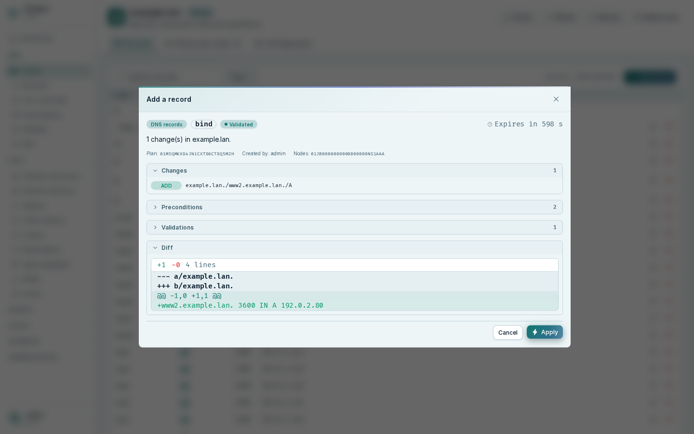
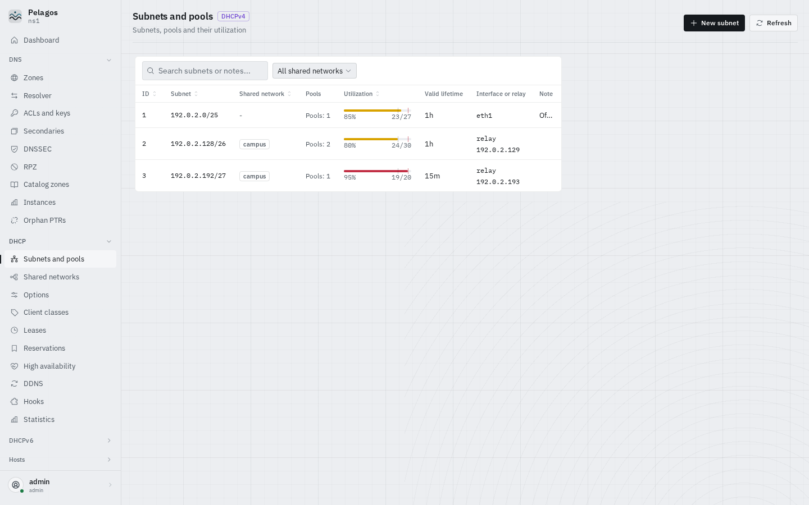
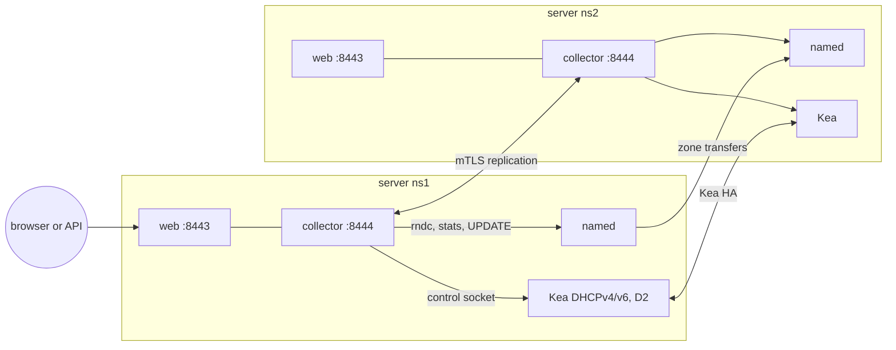

# Pelagos

DNS and DHCP management for BIND 9 and ISC Kea, high availability included.

Pelagos runs one identical node on every DNS/DHCP server: a local agent, a
REST API and a web UI in a single package. The truth stays in the engines:
zones live in `named`, subnets, reservations and leases live in Kea, and
every write goes through their native channels (signed DNS UPDATE, `rndc`,
Kea control sockets, validated include files). Nodes replicate their own
small state over mutual TLS, so any node can be used to manage the whole
cluster.


Status: early release (`0.1`). The feature set below is implemented and
tested against real `named` and Kea daemons; expect rough edges.

## Features

- **DNS (BIND 9)**: zones (primary, secondary, forward, catalog), records
  with a live preview, dynamic zones edited through signed UPDATE, views,
  ACLs and TSIG keys, resolver options, DNSSEC status, RPZ,
  secondaries and transfers, zone sync across servers.
- **DHCPv4 and DHCPv6 (Kea)**: subnets and pools with utilization, shared
  networks, options and client classes, reservations, leases with search
  and release, prefix delegation pools, DDNS (`kea-dhcp-ddns`), hooks.
- **High availability**: Kea HA pairs (hot-standby, load-balancing) with
  state, partner view, unsent updates and a guided maintenance mode; alerts
  when a partner degrades.
- **Hosts**: one card per host joining the lease, the reservation and the
  DNS records (A, AAAA, PTR) from every server, with the inconsistencies
  between them (record without lease, PTR mismatch, reservation without
  lease) and a single plan to create or fix a host.
- **Plans**: every change is a plan first, with its diff, the engine
  validation (`named-checkconf`, `named-checkzone`, Kea `config-test`) and
  its preconditions. Apply it, then roll it back while it is in memory. The
  audit log keeps who changed what, on which node, with the full diff.
- **Replication**: nodes enroll with a one-time token against an internal
  CA, replicate the cluster configuration and the audit log, and catch up
  after an outage.
- **Security audit**: weak TSIG and rndc keys (hmac-md5), open transfers or
  recursion, non-local control channels, `allow-update` by address. Each
  finding comes with a remediation plan, including the key switch between
  BIND and Kea DDNS without losing an update.
- **Advanced editor**: a grammar-driven editor for `named.conf` and the
  Kea JSON configuration, for everything the dedicated screens do not cover,
  still validated and applied as a plan.
- **Import and install**: adopt an existing BIND and Kea setup with a single
  include line added to `named.conf`, or install BIND and Kea (distribution
  packages or ISC repositories) and configure them.
- **UI**: themes (Instrument by default, plus Mission Control and
  others, dark and light; animations at three levels and optional ambient
  backgrounds, both following the reduced-motion setting), English and French,
  dashboard with a live cluster trace, DNS and DHCP rates, nodes, HA, zone
  sync, pool usage and DDNS errors, live updates over WebSocket, roles,
  TOTP, security keys and passkeys.

| Zone record with its plan | DHCP subnets |
| --- | --- |
|  |  |
| **Host card** | **Alerts and inconsistencies** |
|  |  |

## Architecture

Each server runs `named` and Kea as usual, plus the Pelagos node: a web
process (API and UI on HTTPS `:8443`) and a collector (polling, metrics
cache, alerts, replication and enrollment on mTLS `:8444`). The node talks
to its engines on local channels only. Its own state is tiny: `node.toml`
(identity), `cluster.toml` (replicated configuration), an append-only audit
log, and a local SQLite cache of time series. A small root helper, started
per request by a systemd socket, performs package installs and imports.



Details: [user documentation](docs/user/README.md),
[docs/architecture.md](docs/architecture.md) (contracts) and
[docs/design.md](docs/design.md) (design document, in French).

## Supported platforms

| Item | Versions |
| --- | --- |
| deb package | Debian 13 (trixie), amd64 and arm64 |
| rpm package | RHEL, Rocky Linux, AlmaLinux 9 and 10, x86_64 |
| Container images | node and all-in-one, amd64 and arm64, built with `make docker` and `make docker-allinone` |
| BIND | 9.20 |
| Kea | 3.x (3.2 tested) with the `lease_cmds`, `host_cmds`, `subnet_cmds` and `stat_cmds` hooks; Kea 2.6 in a reduced mode (no `subnet_cmds` or `host_cmds`: subnet changes through `config-set`) |
| Browsers | current Chromium, Firefox and Safari |

The packages bundle their own Python environment under `/opt/pelagos`
(Python 3.12 or 3.13 from the distribution); BIND and Kea are not pulled in.

## Installation

### Debian 13 (deb)

```sh
sudo apt install ./pelagos_<version>_amd64.deb
sudo pelagos init --name ns1          # asks for the first admin password
sudo systemctl start pelagos pelagos-collector
```

Open `https://ns1.example.lan:8443/` (self-signed certificate on first
start; replace `/etc/pelagos/tls/server.crt` and `server.key` with your
own). The units are enabled by the package and only start once the node is
initialized.

### RHEL, Rocky, AlmaLinux (rpm)

```sh
sudo dnf install ./pelagos-<version>.el10.x86_64.rpm   # el9 on RHEL 9
sudo pelagos init --name ns1
sudo systemctl start pelagos pelagos-collector
sudo firewall-cmd --permanent --add-port=8443/tcp --add-port=8444/tcp && sudo firewall-cmd --reload
```

### Docker compose

The compose file runs the node next to the official ISC images for BIND
and Kea. No image is published yet: build the node image first.

```sh
make docker
cd docker
PELAGOS_IMAGE=pelagos:latest PELAGOS_ADMIN_PASSWORD='Change-Me-Please-1' docker compose up -d
```

Kea uses the host network to serve DHCP; add the LAN interface to the
seeded `kea-dhcp4.conf`. An all-in-one image (BIND, Kea and the node under
supervisord) is also available. See [docker/README.md](docker/README.md).

Packages and images are built from this repository with `make deb`,
`make rpm`, `make docker` and `make docker-allinone`
([packaging/deb/README.md](packaging/deb/README.md),
[packaging/rpm/README.md](packaging/rpm/README.md)).

## First steps

1. **Initialize the first node**: `sudo pelagos init --name ns1` creates
   the internal CA, the master key, the cluster configuration and the
   first admin account. Or let the installer do everything:
   `sudo pelagos install --engines bind,kea4,d2 --source isc --init`
   installs BIND and Kea 3.2 from the ISC repository, configures them for
   Pelagos and initializes the node.
2. **Import an existing BIND and Kea**: `sudo pelagos import --dry-run`
   shows the plan, `sudo pelagos import` applies it. Pelagos adds one
   `include` line to `named.conf` and one inside `options { }`, writes its
   own files under the include directory, creates its TSIG keys and points
   at the Kea control sockets. Nothing else in your files changes. The
   same import is available from the UI (Install).
3. **Audit**: `sudo pelagos audit` lists security findings;
   `sudo pelagos audit --fix-all` applies their remediation plans.
4. **Enroll a second node**: in the UI, Nodes, create an enrollment token.
   It comes with the command to run on the new server, after installing
   the package there:

   ```sh
   sudo pelagos enroll --url https://ns1.example.lan:8444 --token <token> \
     --ca-fingerprint sha256:<fingerprint> --name ns2
   sudo systemctl start pelagos pelagos-collector
   ```

   Then import ns2's engines the same way. Both nodes now show the whole
   cluster.

The [user documentation](docs/user/README.md) covers installation,
configuration, every screen, plans and rollback, HA maintenance, backup and
restore, upgrades, the CLI, the API and troubleshooting.

## Security notes

- The node processes run as the unprivileged `pelagos` user in hardened
  systemd units; only the installer helper runs as root, one request per
  connection, reachable by the `pelagos` group only.
- Replication and enrollment use mutual TLS with an internal CA; an
  enrollment token is single use and short lived, and the new node pins the
  CA fingerprint. Removing a node revokes its certificate.
- Secrets (TSIG keys, the Kea DDNS key, TOTP seeds) are encrypted at rest
  in `cluster.toml` with the cluster master key (`/etc/pelagos/master.key`,
  mode 0600). Secrets are masked in API responses, plans and the audit log.
- Pelagos uses local channels only: `rndc` and the statistics channel on
  the loopback, Kea control sockets, DNS UPDATE signed with its own key.
- Passwords are hashed with Argon2id; sessions carry a CSRF token; roles
  scope every write (DNS, DHCP, hosts, administration). Enable TOTP for
  administrators.
- Expose `:8443` to administrators only and `:8444` to the other nodes
  only.

Report vulnerabilities privately, never in a public issue: see
[SECURITY.md](SECURITY.md).

## Development

Requirements: Python 3.12 or 3.13 with [uv](https://docs.astral.sh/uv/),
Node 22 with npm, and for the daemon tests BIND 9.20 (`named`,
`named-checkconf`, `rndc`, `tsig-keygen`) and Kea 3.x (`kea-dhcp4`,
`kea-dhcp6`, `kea-dhcp-ddns` and their hooks).

```sh
make dev            # backend/.venv and frontend/node_modules
make lint           # ruff (check and format) + eslint
make test           # unit tier + vitest
make test-daemon    # real named and Kea in a temporary directory
make test-e2e       # Playwright against the mock server
make build-frontend # vite build into frontend/dist
make run            # dev node on http://127.0.0.1:8480 (admin / Admin-Dev-Password-1) + UI on :5173
make screenshots    # regenerate docs/images from the mock server
```

Test tiers are pytest markers: `unit` (no network, no daemons), `daemon`
(starts `named` and Kea as the current user on free ports; skipped when the
binaries are missing; on Debian, disable the AppArmor profile of `named`
first, see [AppArmor](docs/user/troubleshooting.md#apparmor)), and `lab`
(installs packages on disposable VMs, `make test-lab`, see
[scripts/lab/README.md](scripts/lab/README.md)). CI runs lint, the unit
tier on Python 3.12 and 3.13, the frontend checks, the daemon tier against
BIND 9.20 and Kea 3.2, and the end-to-end suite; version tags build the
packages and publish the images.

The frontend can run alone against a mock API: `cd frontend && npm run mock`
in one terminal and `VITE_API_MOCK=1 npm run dev` in another (see
[frontend/README.md](frontend/README.md)). Contribution rules, ownership
and conventions: [AGENTS.md](AGENTS.md).

## License

Apache-2.0. See [LICENSE](LICENSE) and [NOTICE](NOTICE). BIND and Kea are
distributed by ISC under the MPL-2.0.
