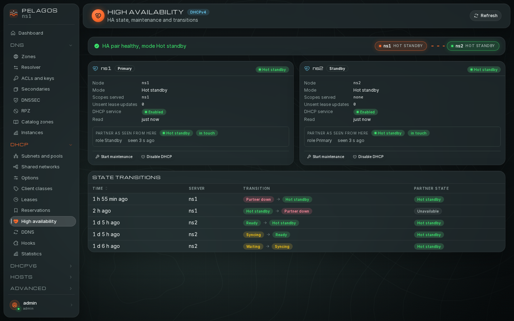

# DHCP screens

The DHCP group drives Kea DHCPv4 on every node that runs it; the DHCPv6
group holds the same screens for Kea DHCPv6 and shows once the DHCPv6
module is on (**Administration, Modules**). Reading needs `read:dhcp`.

To start serving DHCPv6 on a node: `sudo pelagos install --engines kea6`
(it writes a minimal `kea-dhcp6.conf`, listening on no interface), turn the
DHCPv6 module on, add the LAN interface to `interfaces-config` (Kea editor
or **Kea file and running configuration**), then create a subnet with that
interface (`"interface": "eth0"`) or reached through a relay. Clients
without router advertisements must solicit on their own (systemd-networkd:
`[DHCPv6] WithoutRA=solicit`). A reservation is by DUID: the lease list
shows each client's.

- [How DHCP changes are applied](#how-dhcp-changes-are-applied)
- [Subnets and pools](#subnets-and-pools)
- [Shared networks](#shared-networks)
- [Options](#options)
- [Client classes](#client-classes)
- [Leases](#leases)
- [Reservations](#reservations)
- [High availability](#high-availability)
- [DDNS](#ddns)
- [Hooks](#hooks)
- [Statistics](#statistics)
- [Kea file and running configuration](#kea-file-and-running-configuration)

## How DHCP changes are applied

- Configuration plans (subnets, pools, shared networks, reservations,
  classes, options, DDNS parameters, hooks) apply to **every node running
  that Kea engine**, so both HA partners stay identical. Each node gets the
  change computed against its own configuration, checked with
  `config-test`, applied, then persisted to its file. A file without
  `<?include?>` is written by Kea's `config-write`: the first write turns
  it into Kea's own pretty-print with every default spelled out, and its
  comments are lost. A file tree with includes is patched in place
  instead, comments and layout kept.
- With Kea 3.x and the `subnet_cmds` and `host_cmds` hooks, subnets and
  reservations change through those commands. With Kea 2.6 (reduced mode),
  the whole configuration is replaced with `config-set`.
- Each plan carries the configuration hash of every node as a
  precondition: an edit made elsewhere in between makes the apply fail
  instead of overwriting it.
- Notes you type are stored in the Kea `user-context` of the object
  (`"pelagos": {"notes": ...}`).

## Subnets and pools

The subnets of the node read, with ID, prefix, shared network, pools and
their utilization bar (assigned of total, declined), prefix delegation pools
(v6), relays and options. Search covers prefixes and notes; filter by
shared network.

"New subnet" (`write:dhcp.subnets`): ID (unique), prefix
(`192.0.2.0/24`, `2001:db8::/64`), shared network, interface, relay
addresses, pools one per line (`192.0.2.100 - 192.0.2.199` or a prefix),
PD pools for v6 (`2001:db8:8000::/48 56`: prefix, then delegated length),
options one `name = data` per line (`routers = 192.0.2.1`), client classes,
valid and preferred lifetimes, a note. A subnet without pool serves
reservations only. Editing and deleting a subnet are plans too.

Pool use raises `pool_near_full` and `pool_full` at the thresholds of the
settings (80 % and 95 % by default), on two polls in a row, with 5 points of
hysteresis.

## Shared networks

Subnets grouped on one link: name, interface, relay addresses, options,
note, and the member subnets ("Show its subnets"). A subnet joins a shared
network from its own form.

## Options

Global option data (name or code, space, data, CSV format, always send,
never send) and the custom option definitions (code, name, type, array,
record types, space). Subnet, shared network, class and reservation
options are edited on those objects.

## Client classes

Name, test expression (a Kea classification expression such as
`substring(option[60].hex,0,9) == 'PXEClient'`), "Additional list only"
(evaluated only when listed by a subnet or pool), options, and for v4 the
boot fields (next server, server hostname, boot file name), a note.

## Leases

Active leases, page by page, with IP, MAC or DUID, hostname, subnet,
state, expiry, the DNS forward and reverse flags, and the node read.

- **Search**: an IP, a MAC, a DUID or an exact hostname (Kea lookup
  commands). Filters: subnet, state, node. Page size up to 1000.
- **Per-node view** ("Nodes agree", "Nodes disagree"): the same lease on
  every node. In an HA relationship the partners and every backup should
  hold it; "Missing on" names the node that does not.
- **Delete lease** (`ops:dhcp.leases`): a confirmed plan. "Delete on the N
  servers" reaches every Kea server that holds the lease, backups included
  (lease commands are not copied by the `ha` hook, so a copy left on one
  server would come back); the bin icon of one copy deletes it on that node
  only ("Delete the lease on ns2").
- **Host card**: the [host](screens.md#hosts) joining this lease with its
  reservation and records.

A banner "lease changes, refresh" appears when the collector sees leases
come and go.

## Reservations

Reservations by subnet (or global): identifier type (`hw-address`,
`duid`, `client-id`, `circuit-id`, `flex-id`), identifier, IP address (v4)
or addresses and prefixes (v6), hostname, client classes, boot fields,
note. The address must be inside the subnet. Plans need
`write:dhcp.reservations` and go to every Kea node. With a hosts database
configured in Kea and the `host_cmds` hook, reservations are written there.

The [Hosts](screens.md#hosts) screen creates a reservation and its DNS
records in one plan.

## High availability

A Kea HA relationship (`libdhcp_ha.so`) is a pair of active servers
(`primary` and `standby` in hot-standby, `primary` and `secondary` in
load-balancing, or a lone `primary` in passive-backup) plus any number of
`backup` servers. With Kea 3 a server may belong to several relationships
(hub and spoke, below); the screen then has one section per relationship.
Each section shows:

- the summary and the rail: the pair joined by the HA link, then each backup
  after a dashed line (it receives the lease updates);
- "Servers of the relationship": every configured server with its role, the
  node that runs it ("not a Pelagos node" for a server outside the
  cluster), its state (for a server outside the cluster, as its partner last
  saw it), whether its partner is in touch, its lease count (the time of the
  newest lease on hover) and its HA listener URL;
- one card per server Pelagos runs. An active server's card: state, mode,
  role, scopes served, the partner as seen from here (name, state, last
  contact, in touch or not), unsent lease updates, unacked clients, lease
  count, DHCP service enabled or disabled. A backup's card: role Backup,
  what it receives (lease updates from the active servers), the last lease
  update it saw, and its lease count against the primary's ("in step"
  within 2 leases or 1 %, else how far apart, the rule of
  `ha_backup_out_of_sync`);
- the history of state transitions (every relationship).

Alerts:

- `ha_degraded` (warning): a server outside its normal states
  (`hot-standby`, `load-balancing`, `passive-backup`, `backup`) outside a
  maintenance.
- `ha_partner_down` (critical): state `partner-down`, or the partner not in
  touch; the title names the partner. A backup has no partner and never
  raises it. During a maintenance started from Pelagos, the server that
  stays up raises `ha_degraded` instead (below).
- `ha_backup_out_of_sync` (warning): a backup whose lease count stays away
  from the primary's (the active partner's when the primary is not read)
  for 5 minutes: it stopped receiving lease updates.
- `ha_transition` (info): each state change, also kept as a series.

A hub raises these for each of its relationships (the second one and later
carry the server name in their subject, `ha:kea4:<server name>`).

`config_divergence` compares the Kea servers of each relationship on what
they must share: subnets and shared networks (pools, reservations, options,
lifetimes, lease and reservation settings such as `match-client-id`,
`authoritative`, `reservations-*`, T1/T2 and the allocator, classes they
name), the same settings at the global level, global reservations, options,
option definitions and client classes, and the relationship itself (mode, every
peer's name, URL, role and auto-failover). Keys that differ by nature are
left out: `this-server-name`, interfaces, control sockets, loggers, lease
database, hook library paths, the HA hook's timers and multi-threading,
DDNS settings, and the defaults one Kea version writes and another does not
(a backup on Kea 3.0 next to a pair on 2.6 is compared fine). Servers that
belong to no relationship are compared with each other. The alert's details
name the relationship and the hash of each node.
### Set up or edit the relationship

"Set up HA" (no relationship yet) or "Edit relationship" ("Edit
relationships" for a hub, `write:dhcp.config`) opens the relationship form:
per relationship the mode, then one row
per server with its name (`this-server-name`), the URL of its HA listener,
its role and the cluster node that runs it ("not a Pelagos node" for a
server you configure by hand with the same list). "Add a server" adds a
backup. The form refuses what Kea refuses: one primary, exactly one standby
(hot-standby) or secondary (load-balancing), at least one backup in
passive-backup, distinct names and URLs, one server per node. The plan has
one part per node: each node writes the `ha` hook under its own name, adds
`lease_cmds` when it is missing, keeps its other hooks, and rolls back when
a later node refuses. "Remove HA" drops the hook from every node where HA
is on.

Plans survive a restart of the web process until they expire: a setup
previewed, then applied or rolled back after `pelagos` restarted, behaves
as if nothing happened (see [Operations](operations.md#plans-across-restarts)).

### Hub and spoke (Kea 3)

A hub is one Kea 3 server in several relationships, for example the
standby of two sites that each run their own primary. "Add a relationship"
in the form adds one: the hub's server comes prefilled under a new name
(`<name>-2`) and a new port, next to an empty primary. Each relationship has
its own mode and servers; a server name and a URL are used in one
relationship only (the hub listens on its own port in each), and a node runs
one server per relationship. The plan writes on the hub one
`high-availability` entry per relationship, each with its own
`this-server-name`, and on each spoke its own relationship. A subnet goes
to a relationship through `user-context.ha-server-name` (the hub's name in
that relationship); Pelagos does not set it, as only you know which site a
subnet serves. While some of the hub's subnets set none, the plan says so
under the `ha-subnets` check: the hub serves those subnets in every
relationship, and the shared configuration check expects them on every
spoke. Kea 2.6 runs one relationship
per server: a plan putting a Kea 2.6 node in two is refused with
"needs Kea 3.0 or later". "Remove this relationship" in the form drops one;
"Remove HA" drops them all.
### Backup servers

A backup receives every lease update from the active servers and answers no
client; it has no heartbeat, no partner and takes no part in maintenance
("Start maintenance" is not offered on its card, and the API refuses it).
Configuration plans (subnets, reservations, options, classes) reach backups
like any node running the engine.

To **promote a backup** after an active server is lost: on the backup's card,
"Promote". The relationship form opens with the backup in the role of the
lost server (the one not in touch, else the partner of the primary) and that
server as a backup, with no node (its node is likely down, and a plan is
only written on nodes that answer); review, preview and apply. Every
remaining node gets the new peer list. The lost server still runs the old
one: when it returns, give it the new peer list (open the relationship form
and apply it again with its node set, or edit its configuration by hand)
before it serves clients, then it rejoins as a backup and synchronizes its
leases. A server outside the cluster needs the same peer list by hand.

### Maintenance of one server

To reboot or upgrade one server of the pair (`ops:dhcp.ha`):

1. On the card of the server that goes down, "Start maintenance", review
   and confirm the plan. It sends `ha-maintenance-start` to its partner,
   which takes over every client (`partner-in-maintenance`) while the
   server enters `in-maintenance`. The partner is found by its server name,
   from any node of the cluster; backups keep receiving lease updates and
   stay `backup`. For a hub, the plan goes to its partner in every
   relationship (each spoke takes over its own clients). Kea applies
   maintenance to every relationship of the server it is sent to: the
   maintenance of a spoke, sent to its hub, also puts the hub's other
   partners `in-maintenance`; the plan's diff says so.
2. Stop and work on the server. DHCP keeps running on the partner, which
   moves to `partner-down` once the server is gone. Pelagos knows it started
   that maintenance: the partner raises `ha_degraded` (a warning marked
   maintenance), not `ha_partner_down`, until the pair is back, the
   maintenance is ended, or 24 hours have passed. A maintenance started
   outside Pelagos (Kea's own commands) still raises `ha_partner_down`.
3. Start it again: it comes back `waiting`, synchronizes the leases from
   its partner, and the pair returns to its normal state by itself (about a
   minute). There is nothing to end.

"End maintenance" (on the card of the server in `in-maintenance`) is for a
maintenance you started but did not go through: while the server was not
shut down, it sends `ha-maintenance-cancel` and both return to their normal
state. Once the partner is `partner-down`, Pelagos refuses it (`409`).

"Disable DHCP" and "Enable DHCP" (`dhcp-disable`, `dhcp-enable`) stop and
resume answering clients on one server, as confirmed plans. The HA mode and
the peer list change only through the relationship form above or the Kea
configuration ([Getting started: HA pair](getting-started.md#7-a-kea-ha-pair)).

## DDNS

The `dhcp-ddns` connection of the server (where it sends name change
requests), the global `ddns-*` parameters ("Add parameter", JSON values
such as `true`, `25` or `"example.lan."`, `write:dhcp.options`), and the D2
statistics per node (sent, success, error, timeout). `d2_errors` is raised
when (errors + timeouts) / sent over the last hour exceeds
`alerts_d2_error_rate` (5 % by default).

The D2 configuration itself (forward and reverse domains, DNS servers,
TSIG keys) is edited with the Kea editor (D2) or the security audit for the
key. Kea 3.x refuses clear TSIG secrets in the D2 configuration: Pelagos
writes them to secret files (mode 0640, Kea group) under the Kea
configuration directory.

## Hooks

The loaded hook libraries with their parameters; "used by Pelagos" marks
`lease_cmds`, `host_cmds`, `subnet_cmds`, `stat_cmds` and `ha`. "Load a
hook" (`write:dhcp.config`) adds `libdhcp_<name>.so` from the directory of
the hooks already in use, on every node; "Unload" removes one.

## Statistics

Server counters and per-subnet counters (total, assigned, declined,
reclaimed addresses; NA and PD for v6), filterable, a live rate of leases
handed out, and the address use of the last 24 hours.

## Kea file and running configuration

Pelagos compares each Kea configuration file (includes resolved) with what
the daemon runs (`config-get`). When they differ, for example after a hand
edit without `config-reload`, the DHCP screens show a banner "... differs
from the running configuration", the alert `config_divergence` opens, and
configuration plans answer `409 config_divergence` until one side is
adopted:

- **Adopt the file**: Kea loads what the file says.
- **Adopt the running configuration**: the file is rewritten from the
  running configuration, comments kept.

Both are confirmed plans built on the node that holds the file.
