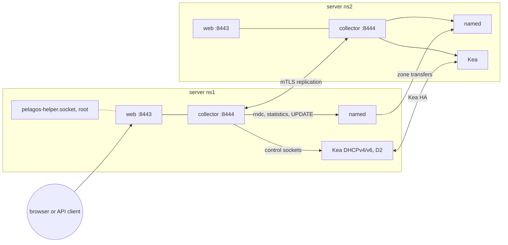

# Overview and concepts

Pelagos manages BIND 9 and ISC Kea from a web UI, a REST API and a command
line. It does not replace them and keeps no copy of their data: zones stay in
`named`, subnets, reservations and leases stay in Kea, and every change goes
through their own channels (signed DNS UPDATE, `rndc`, the Kea control
sockets, validated configuration files).

## Concepts

- **Node**: one Pelagos installation on one DNS/DHCP server. Every node runs
  the same software (a web process and a collector) and shows the whole
  cluster. There is no central server.
- **Engines**: the daemons a node drives on its own server: BIND (`named`),
  Kea DHCPv4 (`kea-dhcp4`), Kea DHCPv6 (`kea-dhcp6`) and the Kea DDNS daemon
  (`kea-dhcp-ddns`, called D2). A node only talks to its local engines, over
  local channels. Which engines a node drives is recorded in its
  `node.toml` (`[engines]`).
- **Cluster**: the nodes enrolled with each other. They replicate a small
  configuration file (`cluster.toml`: users, roles, settings, encrypted
  secrets, the node list) and the audit log over mutual TLS. Engine data is
  never replicated by Pelagos: BIND transfers zones to its secondaries, Kea
  HA synchronizes leases between partners.
- **Plan**: a proposed change with its diff, the engine validations that ran
  (`named-checkconf`, `named-checkzone`, Kea `config-test`) and the
  preconditions checked again at apply time. Nothing is written to an engine
  without a plan. An applied plan can be rolled back for a while. See
  [Plans](plans.md).
- **Roles**: users hold roles; a role is a list of permissions such as
  `read:dns` or `write:dhcp.reservations`. Four roles are built in (`viewer`,
  `dns-operator`, `dhcp-operator`, `admin`); custom roles are replicated
  with the cluster. See [Configuration: roles and permissions](configuration.md#roles-and-permissions).
- **Audit log**: an append-only log of every change and sensitive read, with
  the user, the node, the plan and the diff. It is replicated to every node
  and never purged by Pelagos.
- **Alerts**: conditions the collector of each node evaluates (pool near
  full, HA degraded, serial divergence, DNS/DHCP inconsistencies, weak
  keys...). See [Screens: alerts](screens.md#alerts).

## How a node works

| Process | Unit | Role |
| --- | --- | --- |
| Web | `pelagos.service` | HTTPS UI, REST API and WebSocket on `:8443` (gunicorn, one gevent worker). Reads engines on demand, builds and applies plans. |
| Collector | `pelagos-collector.service` | Polls the local engines and the peers, keeps a local SQLite cache of time series, evaluates alerts, serves replication and enrollment on `:8444` (mutual TLS). |
| Helper | `pelagos-helper.socket` | A root process started per request on `/run/pelagos-helper.sock` (group `pelagos` only) for package installs, imports and security remediations. |

Both long-running processes run as the unprivileged `pelagos` user in
hardened systemd units. The `pelagos` user is a member of the engine groups
(`bind` or `named`, `_kea` or `kea`) so it can read the rndc key, write the
Pelagos include directory and reach the Kea sockets.

## What Pelagos changes in your engines

- **BIND**: two `include` lines, one at the end of `named.conf` and one inside
  its `options { }` block. Everything else Pelagos writes lives in its own
  include directory (`/etc/bind/pelagos` on Debian, `/etc/named/pelagos` on
  RHEL): its TSIG keys `ddi-read` (transfers) and `ddi-admin` (updates), its
  rndc key, ACLs, zones it creates, the options it manages and DNSSEC
  policies. Your files are not rewritten: an option set in your own files is
  read only for Pelagos, and only a security remediation you select (for
  example replacing an `allow-update` by an `update-policy`) edits the
  statement it names, as its plan diff shows.
- **Kea**: changes are loaded through the control sockets, then persisted:
  by Kea's `config-write` for a single file (Kea's pretty-print: comments
  are lost at the first write), by an in-place patch that keeps comments
  and layout for a file tree with `<?include?>`.
  Pelagos metadata (notes) lives in `user-context`.
- **Records**: dynamic zones get signed DNS UPDATE messages; static zones
  get a minimal edit of their zone file (see [DNS zones](../dns-zones.md)).

## Supported platforms and versions

| Item | Versions |
| --- | --- |
| deb package | Debian 13 (trixie), amd64 |
| rpm package | RHEL, Rocky Linux, AlmaLinux 9 and 10, x86_64 (Fedora builds from the same spec) |
| Container images | node image and all-in-one image (Debian 13 base), amd64, built from the repository |
| BIND | 9.20 (Debian 13, the ISC images); 9.18 as RHEL 10 and Rocky 10 ship it is tested too |
| Kea | 3.x, 3.2 tested, with the `lease_cmds`, `host_cmds`, `subnet_cmds` and `stat_cmds` hooks. Kea 2.6 runs in a reduced mode: without `subnet_cmds` and `host_cmds`, subnet and reservation changes replace the whole configuration (`config-set`) and some screens offer less |
| Python | the distribution's 3.12 or 3.13, in a private environment under `/opt/pelagos` |
| Browsers | current Chromium, Firefox and Safari |

BIND and Kea are not dependencies of the packages: install them from the
distribution, from the ISC repositories, or with `pelagos install`.

## Where to go next

- [Installation](installation.md)
- [Getting started](getting-started.md): first node, import, second node, HA pair
- [Configuration reference](configuration.md)
- [Screens](screens.md) and [DNS](dns.md), [DHCP](dhcp.md)
