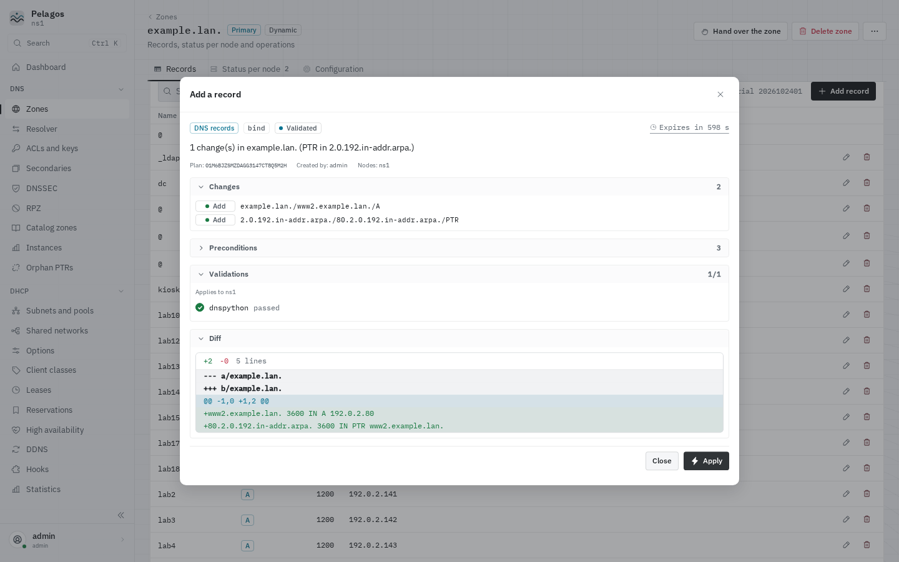

# Plans

Every write, from a screen, the advanced editors, the API or the CLI, is a
plan first. A plan is built from the current state of the engines, shown,
then applied as is or not at all.

## Preview

"Preview the plan" (or any `.../plan` endpoint) builds the plan and opens
the review panel:

- **Changes**: each change with its operation (Add, Replace, Delete) and its
  target nodes. "all nodes" means every node running the engine.
- **Diff**: the record sets before and after, or the file diff
  (`named.conf` includes, zone files, Kea JSON). Secrets show as `***`.
- **Validations**: the checks that ran while building the plan, per node:
  `named-checkconf` on a copy of the configuration, `named-checkzone` on a
  copy of a zone file, Kea `config-test` over the control socket. A plan
  that fails validation cannot be applied; its output names the file and
  the line.
- **Preconditions**: what is checked again right before the apply:
  configuration hash (Kea `config-hash-get`), SOA serial, record set present
  or absent, file checksum, HA state. If something changed in between (an
  edit made elsewhere, a DHCP client renaming itself), the apply fails with
  `precondition_failed` instead of overwriting it. Preview again.
- **Expires in**: the countdown before the plan is dropped.

Plans with a wider impact require an explicit confirmation: deleting a
zone, a key, a DNSSEC policy or a lease, rotating a TSIG key, DNSSEC
rollovers and DS state, HA maintenance, enabling or disabling the DHCP
service, adopting a Kea file, and installer, import and security plans.
Tick "I understand the impact and want to apply this plan"
(`"confirm": true` in the API).

## Apply

"Apply" runs the plan on its target nodes in order, through the write
pipeline on each node:

1. take the engine lock of that node (one write per engine at a time);
2. check the preconditions;
3. back up the files it touches under
   `/var/lib/pelagos/backups/<engine>/<timestamp>-<plan id>/`;
4. write (an UPDATE, a file, a control command);
5. validate, reload (`rndc reload`, Kea `config-set` or `config-reload`),
   verify the result (the new serial, the new configuration hash), and
   persist Kea changes with `config-write`;
6. on any failure, restore the backup on this node and roll back the nodes
   already applied.

The result shows one line per node: applied, failed, rolled back. A node
that did not answer in time is reported with "outcome unknown" and is
rolled back too. Install, import and security plans run as jobs whose steps
show as they progress.

Every apply writes an audit entry per node plus a summary entry with the
full diff (Audit log screen, filterable by plan).

## Expiry

A plan not applied lives `plans.ttl_seconds` (default 600 seconds,
**Administration, Settings**, "Plan lifetime"). A plan that finished (applied,
rolled back or failed) stays `plans.rollback_window_seconds` after it ended
(default 24 hours, at most 7 days, "Rollback window"). Plans are kept by the
web process of the node that built them, encrypted on disk with the master
key, so a restart of `pelagos.service` keeps them:

- a plan past its deadline answers `410 plan_expired`; the review panel
  offers "Recompute the plan" from the same inputs;
- `DELETE /plans/{id}` discards a plan (`404` afterwards).

`GET /plans?state=&user=&scope=&page=&per_page=` lists the plans of the node
you are connected to, newest first, with their state, `finished_at` and
`rollback_until`. With `read:audit` you see every plan of the node and can
open any of them read only; otherwise only your own. `GET /audit?plan_id=`
gives the audit entries of one plan.

## Rollback

An applied plan can be rolled back until its `rollback_until` (the end of
the rollback window), from its result panel ("Roll back") or
`POST /plans/{id}/rollback`. The rollback applies the inverse changes, with
guards checked against the state now, on every node that applied it.

- A record rollback sends the inverse UPDATE (dynamic zones) or writes the
  inverse file edit with a new serial (static zones), so secondaries
  transfer the restored records. A record changed since (another plan, a
  hand edit, DDNS) refuses it.
- A BIND configuration rollback restores the backup only when no file the
  plan wrote changed since, and only while the backup is kept
  (`retention.backups_days`).
- A Kea rollback is refused when the configuration changed since the apply,
  by any plan or by hand (configuration hash guard): roll back the newest
  plan first, or build a new plan.
- A D2 configuration rollback works for `plans.ttl_seconds` after the apply
  and not after a restart, whatever the window says.
- Installer, import, security and Kea migration plans do not roll back as
  a whole: each of their steps restores its own files when it fails.
- DNSSEC key rollovers and DS state changes cannot be rolled back.

A refused rollback answers `409 precondition_failed` and the plan stays
applied, or ends `failed`. A rollback that fails is final: build a new plan.
After the window, restore by hand: the backups under
`/var/lib/pelagos/backups/<engine>/` (also listed in **Advanced, History**,
with the diff since the previous backup) and the `before` state in the
audit entry.

## Plans across nodes

A plan built on one node may run on others. Pelagos picks the node that
holds the data:

| Plan | Built on | Applied on |
| --- | --- | --- |
| Records of a zone this node holds as primary | this node | this node; secondaries transfer |
| Records of a zone this node holds as secondary (or does not hold) | this node, from the primary's records | the node holding the primary |
| New zone with "Also on these nodes, as secondaries" | the primary's node | the primary, then the secondaries |
| Zone change on a node without BIND | the first node running BIND, or the one you pick | that node |
| Subnets, pools, shared networks, reservations, classes, options, DDNS, hooks | this node | every node running that Kea engine (both HA partners) |
| Whole Kea configuration (Kea editor), D2 configuration, adopting a Kea file | the node the configuration was read from | that node only |
| Lease deletion | this node | the node holding the lease |
| HA maintenance start or cancel | this node | the partner of the server going into maintenance |
| DHCP service enable or disable | this node | the node you pick |
| Host (records and reservation) | this node | the primary of each zone, every node running Kea |
| Security remediation of the shared Kea DDNS key | this node | BIND on this node, D2 on every node |
| Kea HA TLS (switch or renewal of the certificates) | a node holding the cluster CA key | every node of the HA set: certificates first, then standby and backups, then primaries, then a check on each |
| HA listener guard, adoption of a hand-made guard, `managed_drift` adopt or restore | the node the guard or object belongs to | that node only |

When the plan is built by a peer (a zone it owns, a Kea file it holds), this
node asks it over the replication channel, stores the plan, and applies it
there; both nodes write audit entries. An offline peer answers
`503 engine_unavailable` at once. Writes are refused with
`503 replication_syncing` while a node catches up with its peers after a
start (a few seconds, at most five minutes).

Runtime operations (**Advanced, Operations**) follow the same rule: pick a
node, and a change runs there, audited on both nodes.
