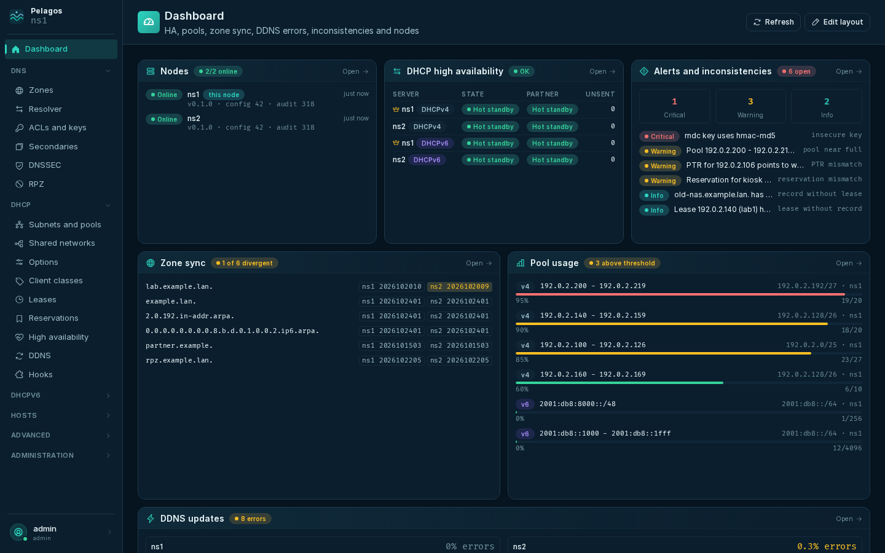
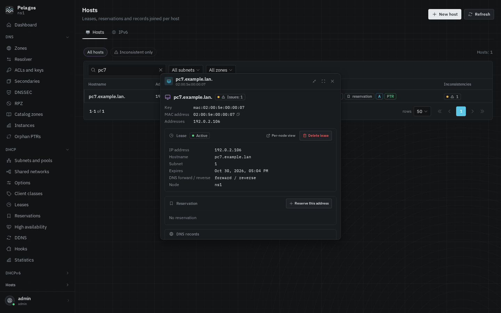
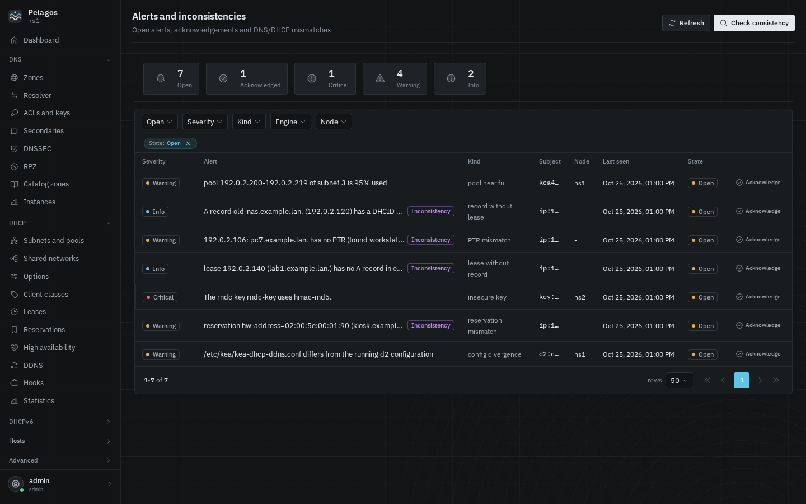
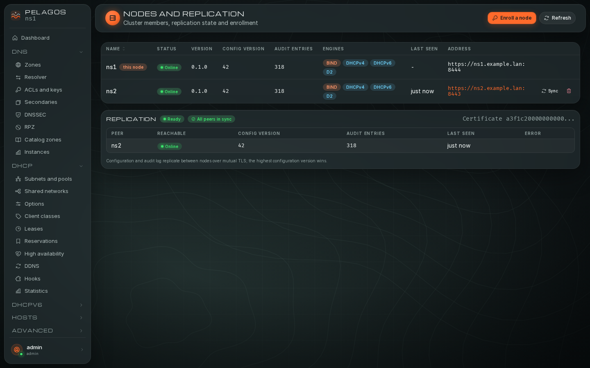
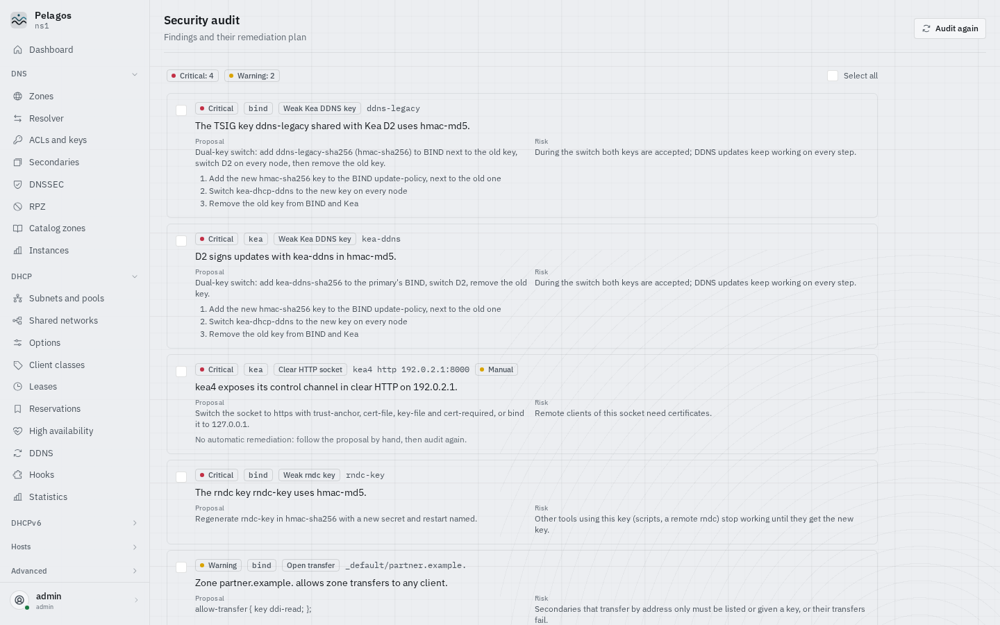

# Screens

The UI is the same on every node. The sidebar groups the screens: DNS,
DHCP, DHCPv6 (when the module is on), Hosts (hosts and alerts), Advanced,
Administration; the user menu at its foot holds the theme, the language
and the account. A screen you lack the permission for is hidden. DNS and
DHCP screens are described in [DNS](dns.md) and [DHCP](dhcp.md).

- [Sign-in](#sign-in)
- [Dashboard](#dashboard)
- [Hosts](#hosts)
- [Alerts](#alerts)
- [Advanced](#advanced)
- [Nodes and replication](#nodes-and-replication)
- [Install and import](#install-and-import)
- [Security audit](#security-audit)
- [Audit log](#audit-log)
- [Users, roles, modules, settings](#users-roles-modules-settings)
- [Account](#account)

## Sign-in

Username and password, then the 6-digit code when two-factor is on. Two
cases limit the session until they are done: an administrator asked for a
new password ("An administrator asks you to choose a new password"), or
two-factor is required for everyone and you have none yet (the Account
screen opens on the enrollment). Sessions belong to the node you signed in
on; opening another node's UI asks you to sign in there.

The indicator in the header shows the live updates (WebSocket): "Live
updates on", "Connecting...", "Live updates off", "Live updates unavailable"
(the socket could not be opened).

## Dashboard

- **Cluster trace**: this node and its peer with their engines, versions and
  HA heartbeats, the link between them (in sync, how far behind, unreachable),
  then a recorder of the last 30 s, 90 s or 5 min: DNS queries, DHCP leases,
  HA heartbeats measured from Kea (interval and jitter, a red line while the
  partner is lost) and events (plans, rollbacks, alerts, replication, HA).
  Point at the trace to read the exact sample under the pointer; near an event
  the pointer snaps to it and names it. The Mission Control theme keeps the
  cluster radar here.
- **DNS**: queries per second (live chart), NXDOMAIN, zone count, answers by
  rcode.
- **DHCP**: leases handed out per second, hot pools, the latest leases with
  the rate of each step (Discover, Offer, Request, Ack; a red last tick when
  NAKs were sent), busiest pools, HA.
- **Nodes**: online count, version, configuration version and audit count
  of each node.
- **DHCP HA**: state of each server, its partner, unsent updates.
- **Alerts**: open alerts by severity.
- **Zone sync**: zones whose serials diverge between nodes.
- **Pool usage**: pools above the warning threshold, and the fill of the
  hottest pool over the last hour against the thresholds; an alert on it
  closes a red latch where it opened and a green one where it resolved.
- **DDNS updates**: D2 success, errors, timeouts and error rate.

"Edit layout" lets you move and resize tiles; "Save layout" keeps it in
your account, "Default layout" restores it. Each tile opens its screen.

## Hosts

One line per host, joining the lease (every Kea node), the reservation and
the A, AAAA and PTR records of every DNS server, with where it was found
(lease, reservation, records). Search by name, IP or MAC; filter by subnet
or zone; "Inconsistent only" keeps the hosts with an open inconsistency.

The **host card** shows the lease, the reservation, the DNS records and
the open inconsistencies, with actions:

- **Create A and PTR** for a lease or reservation without records;
- **Reserve this address** for a leased host;
- **Delete lease**, **Delete** the reservation, **Per-node view** of the
  lease, **Open the zone**, **Open in reservations**.

**New host** (`write:hosts`, or the DNS and DHCP write permissions it
needs): hostname, IP, MAC, forward zone, TTL, "Also create a DHCP
reservation" (subnet chosen from the address, or picked), notes (saved in
the reservation's user-context). The PTR goes to the reverse zone Pelagos
knows for the address ("No known reverse zone: no PTR unless you name
one"). It is one plan: the records go to the primary of each zone, the
reservation to every Kea node.

When BIND has views beyond `_default`, the form also shows "View" (default
`_default`; the zone list follows it) and "Reverse view" (default "Same as
the view": the PTR goes to the reverse zone of the same view; pick
`_default` or another view to put it elsewhere). These are the `view` and
`reverse_view` fields of `POST /hosts/plan`.

## Alerts

Open and acknowledged alerts of every node, with severity, kind, subject,
node, first and last seen. Filters: state, severity, kind, engine, node.

- **Acknowledge** (`write:alerts`): with an optional comment kept in the
  audit log; the acknowledgement replicates to every node. An acknowledged
  alert that resolves and comes back opens again.
- **Check consistency** runs the DNS/DHCP consistency pass now instead of
  waiting for `consistency_seconds`.
- Actions on an alert open the host, the zone, or adopt a Kea file.

| Kind | Severity | Raised when |
| --- | --- | --- |
| `pool_near_full`, `pool_full` | warning, critical | pool use at or above the warning or critical percent on two polls in a row |
| `serial_divergence` | warning | a secondary's serial differs from the primary's longer than `alerts_serial_divergence_seconds` |
| `secondary_stale` | critical | a secondary or mirror zone expires within 24 hours |
| `zone_error` | critical | `rndc zonestatus` fails or the zone is not loaded |
| `ha_degraded` | warning | an HA server outside its normal states, outside a maintenance |
| `ha_partner_down` | critical | state `partner-down`, or partner not in touch |
| `ha_transition` | info | an HA state change |
| `d2_errors` | warning | D2 error rate over the last hour above `alerts_d2_error_rate` |
| `daemon_down` | critical | a local engine does not answer |
| `peer_offline` | warning | a peer unreachable for 3 polls |
| `config_divergence` | warning | Kea configuration hash differs between HA partners, a Kea file differs from the running configuration, or a peer runs a newer `cluster.toml` schema |
| `lease_without_record` | info | an active lease with forward DNS update and no A/AAAA for its hostname |
| `record_without_lease` | info | an A/AAAA with a DHCID whose lease is gone |
| `reservation_mismatch` | warning | a reservation's hostname or IP disagrees with the records |
| `ptr_mismatch` | warning | an A without matching PTR, or a PTR pointing to a name without that A |
| `duplicate_ip` | warning | the same IP in two reservations, or reserved and leased to another client |
| `insecure_key` | warning | a TSIG or rndc key in hmac-md5 or hmac-sha1 (from the security audit) |
| `insecure_listener` | warning | rndc, statistics channel or a Kea HTTP listener open beyond localhost without TLS |

Alerts resolve by themselves when the condition goes away; resolved alerts
are kept `alerts_resolved_days` (90).

## Advanced

Shown when the advanced editor module is on (Operations always).

- **named.conf editor**: the statement tree of every file of the
  configuration (user files and Pelagos files), a form generated from the
  BIND grammar for the statement you select, pending changes, "Validate with
  named-checkconf", and a plan. User files are never rewritten: only the
  statements of the `options` block change there; other statements are added
  to a Pelagos file. Statements unknown to the grammar of the running BIND
  are kept and edited as raw text. Key secrets show as `****`.
- **Kea editor**: the JSON tree of the running configuration of one node
  (Dhcp4, Dhcp6 or D2), checked against the schema of its Kea version, with
  pending changes, "Validate with config-test", and a plan for that node
  only. Read and plan permissions: `read:advanced`, then `write:dns.config`
  or `write:dhcp.config` to apply.
- **History**: the backups the write pipeline took before each write (time,
  engine, node, label, files, plan), with the files' content and the diff
  since the previous backup. Use it to restore by hand after the rollback
  window.
- **Operations**: allow-listed runtime commands, per engine tab (BIND, Kea
  DHCPv4, Kea DHCPv6, Kea DDNS) and per node, split into reads and changes,
  with typed parameters and a help line each. Examples: `status`,
  `zonestatus`, `reload`, `notify`, `retransfer`, `freeze`, `thaw`, `sync`,
  `flush`, `flushname`, `nta-add`, `dnssec-status` for BIND;
  `status-get`, `statistic-get-all`, `config-reload`, `ha-heartbeat`,
  `ha-sync`, `dhcp-disable`, `leases-reclaim`, `lease4-resend-ddns`,
  `lease4-wipe` for Kea. Dangerous ones need the confirmation box. Reads
  need `read:dns` or `read:dhcp`; changes need `ops:dns`, `ops:dhcp.leases`
  (lease commands), `ops:dhcp.ha` (`ha-sync`, `ha-scopes`, `ha-continue`,
  `ha-reset`) or `write:dhcp.config` (including `dhcp-disable` and
  `dhcp-enable`). A command
  the daemon does not offer (hook not loaded) is disabled. Every change is
  audited.

## Nodes and replication

Every node: name, address (its web URL opens its UI), engines, status,
version, configuration version, audit entries, last seen, error. The
replication panel says "All peers in sync" or "Peers differ", with this
node's configuration version and the CA certificate fingerprint.

- **Enroll a node** (`admin:nodes`): a one-time token valid 15 minutes, 1
  hour or 24 hours, the CA fingerprint and the command to run on the new
  server ([Getting started](getting-started.md#5-enroll-a-second-node)).
- **Sync**: exchange configuration and audit with that peer now.
- **Remove**: the node leaves the cluster; its certificate is revoked and
  refused by the others. Its BIND and Kea keep running. A node cannot
  remove itself: do it from another node.

## Install and import

**Detected on this node**: each engine with installed, version, service,
running, configuration, plus the Pelagos checks (include lines in
`named.conf`, control sockets reachable, keys `ddi-read` and `ddi-admin`
present). Then a four-step wizard:

1. **Mode**: "Import an existing configuration" or "Install engines".
2. **Engines**: BIND 9, Kea DHCPv4, Kea DHCPv6 (when the module is on),
   Kea DHCP-DDNS. Engines already installed are offered for import, missing
   ones for install.
3. **Packages** (install): distribution packages, or the ISC repositories
   with a Kea series.
4. **Review and apply**: "Build the plan", review, apply; the job's steps
   show as they run.

The same as `pelagos install` and `pelagos import`, run as root through the
helper (`admin:install`).

## Security audit

Findings of the BIND and Kea configuration of this node, each with its
severity, description, proposal and risk. Select findings, "Build the
remediation plan", review, apply: they are fixed one after the other, each
with backup, write, validation, reload, check, and rollback if a step fails.
The collector runs the same audit every `consistency_seconds` and raises
`insecure_key` and `insecure_listener` alerts from it.

| Finding | Severity | Remediation |
| --- | --- | --- |
| `weak_rndc_key` | critical (md5), warning | new rndc key in hmac-sha256, named restarted |
| `weak_tsig_key` | critical (md5), warning | new secret in hmac-sha256 for that key |
| `weak_shared_kea_key` | critical (md5), warning | dual-key switch: add the new key to BIND next to the old one, switch D2 on every node, remove the old key |
| `allow_update_by_address` | critical | `allow-update` by address replaced by an `update-policy` with a key |
| `open_recursion` | critical | `allow-recursion { localhost; localnets; };` |
| `dnssec_validation_off` | warning | `dnssec-validation auto;` |
| `rndc_nonlocal` | critical | rndc control channel moved to the loopback |
| `stats_nonlocal` | warning | statistics channel moved to the loopback |
| `update_without_admin_key` | warning | `ddi-admin` (or the view key) added to the zone's `update-policy` or `allow-update` |
| `transfer_without_read_key` | warning | `key ddi-read` added to `allow-transfer` |
| `open_allow_transfer` | warning | `any` replaced by `key ddi-read` (other elements kept) |
| `kea_ctrl_agent_http` | critical, warning when local | `kea-ctrl-agent` stopped and disabled (Pelagos uses the Unix sockets) |
| `kea_http_socket_plain` | critical | none automatic: switch the socket to HTTPS or bind it to `127.0.0.1` |
| `kea_socket_dir_mode` | warning | socket directory back to 0750 |
| `kea_tsig_clear_secret` | info | D2 secret moved to a secret file |
| `static_zone` | info | `update-policy` granting the admin key (the zone becomes dynamic) |
| `view_key` | warning | a key per view and the `match-clients` that select it |

Ids are `<engine>:<kind>:<subject>`, the same as `pelagos audit` prints.
A `weak_shared_kea_key` finding lists its three steps under the proposal;
it comes from the `bind` engine when BIND and D2 run on this node, and from
the `kea` engine when only D2 does (the BIND side is on another node).
Findings marked "Manual" (`kea_http_socket_plain`, and `rndc_nonlocal` or
`stats_nonlocal` when Pelagos reaches a remote BIND over the network)
have no automatic remediation: their checkbox is disabled and "Select all"
skips them.

## Audit log

Every change and sensitive read from every node: time, user, action,
target, engine, node, result. Filters: user, action family (DNS, DHCP, DDNS,
Hosts, Installation, Import, Security, Sign-in, Administration, Alerts,
Nodes, Replication), target, engine, node, result, time range. An entry
opens with its plan id, client address, diff, the request sent to the
engine (the DNS UPDATE text, the Kea command) and the response. "Export
NDJSON" downloads the filtered range (`GET /api/v1/audit/export`).

Entries are never edited or purged; failed sign-ins and secret reveals are
recorded too.

## Users, roles, modules, settings

Under Administration:

- **Users** (`admin:users`): create (username, initial password, roles),
  edit roles, enable or disable, "Must change the password", "Reset
  password", "Clear two-factor", delete. A disabled account cannot sign in
  on any node; a deleted one keeps its audit entries.
- **Roles** (`admin:roles`): built-in roles (read only) and custom roles,
  with permissions grouped by family.
- **Modules** (`admin:modules`): cluster features (DHCPv6, Advanced editor)
  and the engines of each node
  ([Configuration: modules](configuration.md#modules)).
- **Settings** (`admin:settings`): General, DNS, Kea, Alert thresholds,
  Collector, Retention ([Configuration: settings](configuration.md#settings)).

## Account

Profile (username, roles, last sign-in, node), password change, two-factor
(set up with a QR code or the secret, confirm with a code; turn off with
your password, unless required for everyone), and preferences: language,
theme family, mode, animations.
